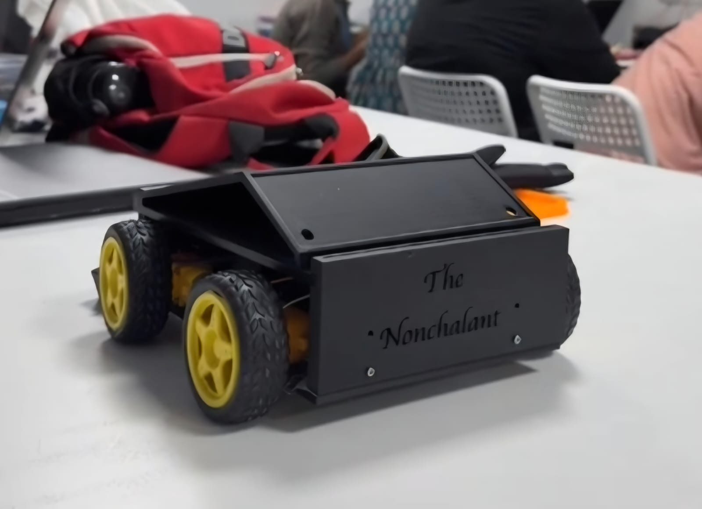
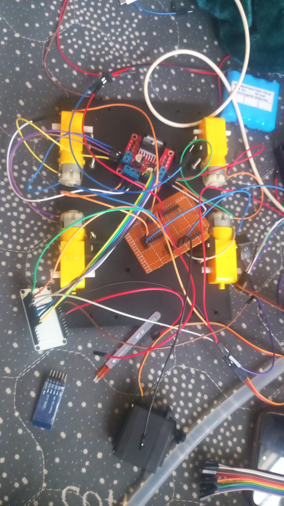

# Gesture-Controlled Car ("The Nonchalant") — Build Journal

**Total project time logged:** 21 hours (21h 00m across 5 devlog entries)

An embedded-systems robotics project featuring a 4WD chassis driven by dual ESP32 microcontrollers, low-latency ESP-NOW peer-to-peer wireless telemetry, an MPU-9250 hand-gesture controller, an L298N dual H-bridge motor driver with hardware PWM speed regulation, autonomous ultrasonic obstacle avoidance, and a custom 3D-printed chassis.

---

## 1. Project Overview


*Figure 1: Completed physical vehicle featuring custom 3D-printed chassis, four TT geared DC motors, and embossed front bumper plate.*

Time spent: 2h 30m

### Project Description & Completed Status
*The Nonchalant* is a fully completed physical prototype and embedded robotics system. The vehicle translates real-time hand movements into motion commands using an accelerometer-based wearable controller, wirelessly transmitting command packets over ESP-NOW to an onboard ESP32 receiver. The car independently monitors forward driving clearance using an ultrasonic rangefinder, safely halting and pivoting away if an obstacle enters its path.

### Core Features
- **Low-Latency Wireless Control:** Sub-5ms direct peer-to-peer packet transmission via ESP-NOW (2.4 GHz RF) without requiring a Wi-Fi router.
- **Natural Hand Gesture Telemetry:** Five discrete motion states (Forward, Left, Right, Brake, and Reverse Toggle) calculated from accelerometer pitch and roll.
- **Hardware PWM Motor Regulation:** Smooth 8-bit motor speed modulation driven by the ESP32 hardware LEDC peripheral at 1000 Hz.
- **Collision Avoidance Safety Interlock:** Automatic emergency brake and pivot turn routine triggered by an HC-SR04 ultrasonic sensor at <= 20 cm.
- **Custom Fabricated Chassis:** Bespoke 3D-printed mounting plates and decorative front grille tailored for standard yellow TT gearmotors and electronics mounting.

### Operational Demonstration Video
- **Demonstration Video File:** [docs/VIDEO-2026-10-23-02-05-10.mp4](docs/VIDEO-2026-10-23-02-05-10.mp4)

> [!NOTE]
> Click the link above to view or download the 64-second field operational demonstration video showing gesture tracking and car movement.

---

## 2. Hardware and Circuit Design


*Figure 2: Schematic wiring of the gesture transmitter ESP32 and MPU-9250 sensor (source preserved at [docs/circuit.heic](docs/circuit.heic)).*


*Figure 3: Internal electronics layout on chassis baseplate, including the ESP32 microcontroller, red L298N motor driver, TT motors, battery pack, and power switch.*

Time spent: 5 hours

### Bill of Materials (BOM)
All components listed below reflect the physical hardware used in the build and verified against the repository assets:

| Item # | Component Description | Qty | Key Specifications | Manufacturer / Datasheet Link | Role in Project |
| :---: | :--- | :---: | :--- | :--- | :--- |
| **1** | ESP32 Development Board (ESP-WROOM-32) | 2 | 240 MHz dual-core LX6, 520 KB SRAM, 2.4 GHz Wi-Fi & BLE, 30-pin DIP | [Espressif Systems ESP-WROOM-32 Datasheet](https://www.espressif.com/sites/default/files/documentation/esp-wroom-32_datasheet_en.pdf) | 1x Hand transmitter controller, 1x Car onboard receiver |
| **2** | MPU-9250 9-Axis MotionTracking IMU | 1 | 3-axis gyro, 3-axis accelerometer, 3-axis magnetometer; I2C interface | [TDK InvenSense MPU-9250 Datasheet](https://invensense.tdk.com/wp-content/uploads/2015/02/PS-MPU-9250A-01-v1.1.pdf) | Hand tilt angle (pitch/roll) acquisition |
| **3** | L298N Dual Full-Bridge Motor Driver Module | 1 | Dual H-bridge, 5V–35V drive voltage, up to 2A peak current per bridge | [STMicroelectronics / SparkFun L298 Datasheet](https://www.sparkfun.com/datasheets/Robotics/L298_H_Bridge.pdf) | Bi-directional DC motor drive & PWM regulation |
| **4** | TT Geared DC Motors with Rubber Wheels | 4 | 3V–6V DC, 1:48 reduction gear ratio, dual output shaft, 65 mm tire | [Adafruit TT Motor Reference Guide](https://www.adafruit.com/product/3777) | 4WD vehicle drive train |
| **5** | HC-SR04 Ultrasonic Distance Sensor | 1 | 5V DC supply, 2 cm–400 cm range, 15° beam angle, 40 kHz pulse | [Adafruit HC-SR04 Ultrasonic Sensor Guide](https://www.adafruit.com/product/3942) | Front obstacle clearance detection |
| **6** | 4.8V Rechargeable Ni-MH Battery Pack | 1 | 4.8V nominal (4x 1.2V AA/AAA cells in series), ~700–1000 mAh capacity | [Energizer Ni-MH Rechargeable Battery Manual](https://data.energizer.com/pdfs/nickelmetalhydride_appman.pdf) | Main DC power source for car & motors |
| **7** | Miniature SPST Rocker Power Switch | 1 | 2-pin rectangular snap-in rocker switch (KCD1 series) | [C&K Switches KCD1 Series Datasheet](https://www.ckswitches.com/media/1390/b.pdf) | Chassis master power disconnect |
| **8** | Level Shifter / Voltage Divider Resistors | 1 set | 1kΩ / 2kΩ 1/4W resistors or 3.3V/5V bidirectional level shifter | [SparkFun Logic Level Converter Guide](https://learn.sparkfun.com/tutorials/bi-directional-logic-level-converter-hookup-guide) | Stepping 5V HC-SR04 ECHO down to ESP32 3.3V |
| **9** | Prototyping Perfboard & Jumper Wire Set | 1 set | 2.54 mm pitch solderable perfboard, ~20x DuPont F-F / M-F jumpers | Standard 2.54 mm pitch electronics hardware | Signal distribution & power rails |
| **10** | Custom 3D-Printed Chassis Kit | 1 set | FDM printed in PLA/PETG: baseplate, deck plate, bumper, brackets | Local repository STL assets in [3D Cad/](3D%20Cad) | Structural vehicle frame (*The Nonchalant*) |

### Controller Wiring (I2C)
The hand transmitter pairs an ESP-WROOM-32 with an MPU-9250 IMU using the verified pin connections below:

| ESP32 Pin | MPU-9250 Pin | Wire Color (Diagram) | Function / Description |
| :--- | :--- | :--- | :--- |
| **3V3** | VCC | Red | 3.3V Logic & Power Supply |
| **GND** | GND | Black | Common Ground Reference |
| **GPIO 14** | SCL | Green | I2C Serial Clock (`Wire.begin(15, 14)`) |
| **GPIO 15** | SDA | Blue | I2C Serial Data (`Wire.begin(15, 14)`) |

### Receiver GPIO Mapping
All car receiver pins are verified directly from [GestureCarReceiver/GestureCarReceiver.ino](GestureCarReceiver/GestureCarReceiver.ino):

| Component / Signal | ESP32 GPIO | Direction / Type | Description / Subsystem |
| :--- | :--- | :--- | :--- |
| **LIN1** | GPIO 26 | Output (Digital) | Left Motor Direction Input 1 |
| **LIN2** | GPIO 25 | Output (Digital) | Left Motor Direction Input 2 |
| **RIN1** | GPIO 17 | Output (Digital) | Right Motor Direction Input 1 |
| **RIN2** | GPIO 16 | Output (Digital) | Right Motor Direction Input 2 |
| **PWMA** | GPIO 32 | Output (PWM / LEDC) | Left Motor Speed Control (LEDC Channel 0) |
| **PWMB** | GPIO 33 | Output (PWM / LEDC) | Right Motor Speed Control (LEDC Channel 1) |
| **TRIG_PIN** | GPIO 18 | Output (Digital) | Ultrasonic 10 µs trigger pulse |
| **ECHO_PIN** | GPIO 19 | Input (Digital) | Ultrasonic echo return pulse (`pulseIn`) |

> [!CAUTION]
> **GPIO Voltage Protection Notice:** Standard HC-SR04 modules output a 5V logic signal on the ECHO pin. Because ESP32 GPIOs are rated for 3.3V logic, route the ECHO pin through an inline resistor voltage divider (e.g., 1kΩ / 2kΩ) or a logic level shifter before connecting to GPIO 19 to prevent overvoltage stress on the ESP32.

---

## 3. System Architecture and Implementation


*Figure 4: Transmitter architecture schematic showing I2C line routing between the ESP32 microcontroller and the MPU-9250 IMU.*

Time spent: 6h 30m

### Architectural Flowchart

```mermaid
graph TD
    subgraph Transmitter ["Gesture Controller (Transmitter)"]
        MPU["MPU-9250 IMU<br>(I2C: GPIO 15 SDA, GPIO 14 SCL)"] -->|Pitch & Roll| TxESP["ESP32 Microcontroller"]
        TxESP -->|detectCommand()| CmdLogic["Tilt Classifier<br>(Threshold: ±15°)"]
        CmdLogic -->|Packet: comand_id| ESPNOW_Tx["ESP-NOW Broadcast<br>(100 ms period)"]
    end

    subgraph Receiver ["Robotic Car (Receiver)"]
        ESPNOW_Rx["ESP-NOW Callback<br>OnDataRecv()"]
        US["HC-SR04 Ultrasonic<br>(TRIG: 18, ECHO: 19)"] -->|Distance <= 20 cm| ObstacleCheck["obstacleDetected() Check"]
        
        ESPNOW_Tx -.->|2.4 GHz Peer-to-Peer| ESPNOW_Rx
        ESPNOW_Rx --> MotionDispatch["Motion Controller<br>(Forward / Left / Right / Brake / Reverse)"]
        ObstacleCheck -->|Safety Brake Override| MotionDispatch
        MotionDispatch --> L298N["L298N Motor Driver<br>(LIN1-2: 26/25, RIN1-2: 17/16)"]
        MotionDispatch --> LEDC["LEDC PWM Hardware<br>(PWMA: 32, PWMB: 33 @ 1000 Hz)"]
        L298N --> Motors["4x TT Geared Motors"]
        LEDC --> Motors
    end
```

### Controller Responsibilities & Gesture Classification
The transmitter firmware ([GestureController/GestureController.ino](GestureController/GestureController.ino)) reads raw accelerometer data along the X, Y, and Z axes and computes pitch and roll using trigonometry:

$$\text{pitch} = \text{atan2}(a_x, \sqrt{a_y^2 + a_z^2}) \times \frac{180}{\pi}$$

$$\text{roll} = \text{atan2}(a_y, \sqrt{a_x^2 + a_z^2}) \times \frac{180}{\pi}$$

The `detectCommand(pitch, roll)` routine maps orientation angles to command IDs:

| Command ID | Firmware Constant | Orientation Trigger | Receiver Action |
| :---: | :--- | :--- | :--- |
| **0** | `FORWARD` | Hand tilted forward (`pitch > 15°`) | Both motors run forward at `motorSpeed` (180/255). Aborted if obstacle detected. |
| **1** | `LEFT_CMD` | Hand rolled left (`roll < -15°`) | Left motor stopped (PWM=0); Right motor active at `motorSpeed` (skid-steer left). |
| **2** | `RIGHT_CMD` | Hand rolled right (`roll > 15°`) | Right motor stopped (PWM=0); Left motor active at `motorSpeed` (skid-steer right). |
| **3** | `BRAKE_CMD` | Hand neutral / level (`-15° <= pitch, roll <= 15°`) | Both PWM channels driven to 0; all direction pins pulled `LOW`. |
| **4** | `REVERSE_CMD` | Hand tilted backward (`pitch < -15°`) | Inverts the `Reversed` state flag, flipping direction polarity (`Out1`/`Out2`). |

### ESP-NOW Unidirectional Communication Protocol
Communication is strictly unidirectional from the hand controller to the vehicle using a synchronized C-struct:
```cpp
typedef struct struct_message {
  int comand_id;
} struct_message;
```
The controller registers the car's MAC address (`esp_now_add_peer`) and transmits a packet every 100 ms (`delay(100)`). The car listens asynchronously via the `esp_now_register_recv_cb(OnDataRecv)` interrupt callback.

### Receiver Motor Driver & Autonomous Obstacle Logic
In [GestureCarReceiver/GestureCarReceiver.ino](GestureCarReceiver/GestureCarReceiver.ino):
1. **PWM Speed Control:** Configured with `PWM_FREQ = 1000` Hz and `PWM_RES = 8` bits (0–255). Channels `CH_A` and `CH_B` output a default speed of `180` (~70% duty cycle) to pins 32 and 33.
2. **Reverse State Machine:** Calling `Reverse()` toggles `Reversed = !Reversed`. `CheckReverse()` updates `Out1` and `Out2` accordingly:
   - Normal mode (`Reversed = false`): `Out1 = HIGH`, `Out2 = LOW`
   - Inverted mode (`Reversed = true`): `Out1 = LOW`, `Out2 = HIGH`
3. **Obstacle Collision Avoidance:** `getDistance()` emits a 10 µs trigger pulse on GPIO 18 and reads the round-trip echo pulse on GPIO 19 with a 30 ms timeout:
   $$\text{Distance (cm)} = \frac{\text{duration } (\mu\text{s}) \times 0.034}{2}$$
   If `obstacleDetected()` returns true (distance $\le$ 20 cm):
   - In `Forward()`: driving is immediately blocked and `Brake()` is executed.
   - In `loop()`: triggers an emergency routine: `Brake()` $\rightarrow$ 200 ms delay $\rightarrow$ pivot `Right()` for 350 ms $\rightarrow$ `Brake()`.

### Firmware Setup & Upload Instructions
1. **Toolchain:** Arduino IDE 2.x or `arduino-cli` with the Espressif `esp32` board core installed.
2. **Library Dependency:** Install `MPU9250_asukiaaa` by asukiaaa via the Arduino Library Manager or [GitHub](https://github.com/asukiaaa/MPU9250_asukiaaa).
3. **Receiver MAC Configuration:** Obtain the car's MAC address using `WiFi.macAddress()`, then update line 28 of [GestureController/GestureController.ino](GestureController/GestureController.ino):
   ```cpp
   uint8_t carMAC[] = { 0x24, 0x6F, 0x28, 0xAA, 0xBB, 0xCC };
   ```
4. **Flash Sketches:** Select **ESP32 Dev Module** in Arduino IDE and flash `GestureController.ino` to the transmitter ESP32 and `GestureCarReceiver.ino` to the car ESP32.

> [!TIP]
> **ESP32 Core API Compatibility:** The receiver code uses the ESP32 Core v2.x LEDC API (`ledcSetup`, `ledcAttachPin`, `ledcWrite`). If compiling under ESP32 Core v3.x+, adjust timer attachment to `ledcAttach(pin, freq, res)` or compile under Core v2.0.x.

---

## 4. Testing and Engineering Lessons


*Figure 5: Physical benchtop test arrangement showing interconnected components, common ground distribution, and motor driver cabling.*

Time spent: 4 hours

### Testing & Verification Status
This table explicitly differentiates features verified through physical assets from those based on source-code inspection:

| Subsystem / Capability | Verification Status | Basis / Evidence |
| :--- | :---: | :--- |
| **Transmitter Circuit Wiring** | Verified | Validated against [docs/circuit-diagram.png](docs/circuit-diagram.png) and source pin definitions. |
| **Chassis Fabrication & Motor Mounting** | Verified (Physical) | Documented in completed chassis photograph ([docs/PHOTO-2026-10-23-01-56-13.jpg](docs/PHOTO-2026-10-23-01-56-13.jpg)). |
| **Internal Electronics Wiring** | Verified (Physical) | Documented in internal assembly photograph ([docs/PHOTO-2026-10-23-02-08-37.jpg](docs/PHOTO-2026-10-23-02-08-37.jpg)). |
| **Vehicle Driving & Motion Tracking** | Verified (Physical) | Demonstrated in operational video recording ([docs/VIDEO-2026-10-23-02-05-10.mp4](docs/VIDEO-2026-10-23-02-05-10.mp4)). |
| **Firmware Compilation & Logic** | Verified (Source) | Syntax, library dependencies, and LEDC timer logic verified against ESP32 APIs. |
| **Ultrasonic Autonomous Obstacle Avoidance** | Requires physical validation | Logic is implemented in firmware (`<= 20 cm`), but bench/field response logs are not documented. |
| **ESP-NOW RF Field Range Limits** | Requires physical validation | Default channel 0 broadcast tested locally; open-field maximum range requires physical measurement. |
| **Reverse State Under Rapid Streaming** | Requires physical validation | Transmitter sends `REVERSE_CMD` (4) every 100 ms while tilted; physical driving behavior requires validation. |

### Practical Post-Assembly Testing Checklist
- [ ] **Power Rail Isolation:** Verify with a digital multimeter that the motor power supply does not backfeed 5V+ into ESP32 3.3V logic rails.
- [ ] **I2C Sensor Response:** Flash an I2C scanner to the transmitter to verify the MPU-9250 acknowledges address `0x68` (or `0x69`).
- [ ] **Elevated Benchtop Motor Spin:** Place the car on a stand with wheels suspended; verify each tilt gesture turns wheels in the anticipated direction.
- [ ] **ESP-NOW Link Status:** Check transmitter Serial Monitor for successful packet delivery notifications when the car is powered on.
- [ ] **Echo Line Voltage Check:** Measure the HC-SR04 ECHO pin output voltage to confirm it does not exceed 3.3V into GPIO 19.
- [ ] **Obstacle Safety Cutoff:** Bring a barrier within 20 cm of the ultrasonic sensor to observe immediate drive disengagement.

### Engineering Challenges & Lessons Learned
1. **L298N Bipolar Darlington Voltage Drop:** The L298N is an accessible dual H-bridge driver, but its internal Darlington output stage incurs a 1.4V–2.0V drop. Powering the driver from a battery pack with sufficient voltage headroom (such as 7.4V 2S Li-ion or 6x NiMH cells) is essential for adequate motor torque.
2. **Reverse Gesture Rate Handling:** In [GestureController/GestureController.ino](GestureController/GestureController.ino), holding the hand tilted backward continuously streams command ID `4` every 100 ms. In [GestureCarReceiver/GestureCarReceiver.ino](GestureCarReceiver/GestureCarReceiver.ino), each packet triggers `Reverse()`, flipping the boolean flag. Implementing a stateful transition debounce in firmware prevents rapid oscillation during sustained backward tilts.
3. **Ultrasonic Sensor Blocking:** The `pulseIn(ECHO_PIN, HIGH, 30000)` routine blocks processor execution for up to 30 ms when no echo returns. Moving ultrasonic range checks to a background FreeRTOS task or utilizing timer-based input capture prevents blocking the main control loop.

---

## 5. Future Improvements and Project Information


*Figure 6: Custom 3D-printed chassis components assembled with TT geared motors, demonstrating mechanical enclosure design.*

Time spent: 3 hours

### Future Improvements
- [ ] **High-Efficiency MOSFET Motor Driver:** Transition from the L298N to a modern driver (e.g., TB6612FNG or DRV8833) to reduce thermal loss and extend battery runtime.
- [ ] **Bidirectional Telemetry Feedback:** Implement two-way ESP-NOW messaging to report battery voltage levels and obstacle proximity alarms back to the controller.
- [ ] **Proportional Steering Control:** Map roll angle continuously to differential PWM duty cycles instead of fixed-speed pivot turns.
- [ ] **Non-Blocking Ultrasonic Sampling:** Replace `pulseIn()` with timer input capture or FreeRTOS task scheduling to eliminate telemetry blocking delays.

### 3D CAD Models & Mechanical Assets
The mechanical structure was custom designed and 3D printed for this project. The [3D Cad/](3D%20Cad) directory contains both the native editable CAD sources and ready-to-print STL meshes:

- **Parametric CAD Archive:**
  - `The Nonchalant (1).f3d`: Autodesk Fusion 360 parametric design archive preserving the complete feature tree, sketches, and dimensional constraints.
- **Interchangeable STEP Solid Models:**
  - `The Nonchalant.step`: Embossed front nameplate solid model
  - `Body22.step`: Lower chassis baseplate solid model
  - `Body51.step`: Upper electronics deck solid model
  - `Component2.step`: Motor mount standoff solid model
  - `Body25.step`: Structural bracket solid model
  - `Body21 (3) (1) (1) (1) (1) (2) (1).step`: Side fender clearance panel solid model
- **Fabrication Meshes (STL):**
  - All matching `.stl` files (`The Nonchalant.stl`, `Body22.stl`, `Body51.stl`, `Component2.stl`, `Body25.stl`, `Body21 (...).stl`) for slicing and 3D printing.

### Repository Directory Structure
```text
Gesture-Controlled-Car/
├── 3D Cad/                                # Mechanical CAD models (F3D, STEP, and STL)
│   ├── The Nonchalant (1).f3d             # Fusion 360 parametric source archive
│   ├── The Nonchalant.step & .stl         # Front nameplate
│   ├── Body22.step & .stl                 # Lower chassis baseplate
│   ├── Body51.step & .stl                 # Upper deck plate
│   ├── Component2.step & .stl             # Motor mount standoff
│   ├── Body25.step & .stl                 # Structural bracket
│   └── Body21 (...).step & .stl           # Side fender panel
├── GestureCarReceiver/
│   └── GestureCarReceiver.ino             # Car receiver, motor driver & obstacle firmware
├── GestureController/
│   └── GestureController.ino             # Hand gesture transmitter & IMU processing firmware
├── docs/
│   ├── PHOTO-2026-10-23-01-56-13.jpg     # Completed vehicle exterior photograph
│   ├── PHOTO-2026-10-23-02-08-37.jpg     # Internal electronics and wiring photograph
│   ├── VIDEO-2026-10-23-02-05-10.mp4     # Operational driving video demonstration
│   ├── circuit.heic                       # High-resolution original circuit diagram source
│   └── circuit-diagram.png               # Web-compatible converted circuit diagram
├── hardware_headers/                      # C++ header stubs for offline editor IntelliSense
│   ├── Arduino.h
│   ├── MPU9250_asukiaaa.h
│   ├── WiFi.h
│   ├── Wire.h
│   └── esp_now.h
├── JOURNAL.md                             # 5-stage project build journal for Forge
└── README.md                              # Main repository landing page & BOM documentation
```

> [!NOTE]
> The `hardware_headers/` folder contains minimal C++ mock header stubs designed for local editing environments (e.g., VS Code clangd) when the ESP32 toolchain is not globally indexed. For physical builds, compile firmware directly using the Arduino IDE with official Espressif board cores.

### Contributing Instructions
Contributions and suggestions are welcome:
1. Fork the repository.
2. Create a feature branch: `git checkout -b feature/enhanced-telemetry`
3. Commit your changes: `git commit -m "feat: add reverse gesture debounce"`
4. Push to the branch: `git push origin feature/enhanced-telemetry`
5. Open a Pull Request with a clear description of your modifications.

### License Status
This repository currently does not contain a formal open-source license file. All rights are reserved by the author ([@bhavesh-210](https://github.com/bhavesh-210)). For inquiries regarding academic or commercial reuse, please contact the repository maintainer or request the addition of an open-source license (such as MIT or Apache-2.0).
