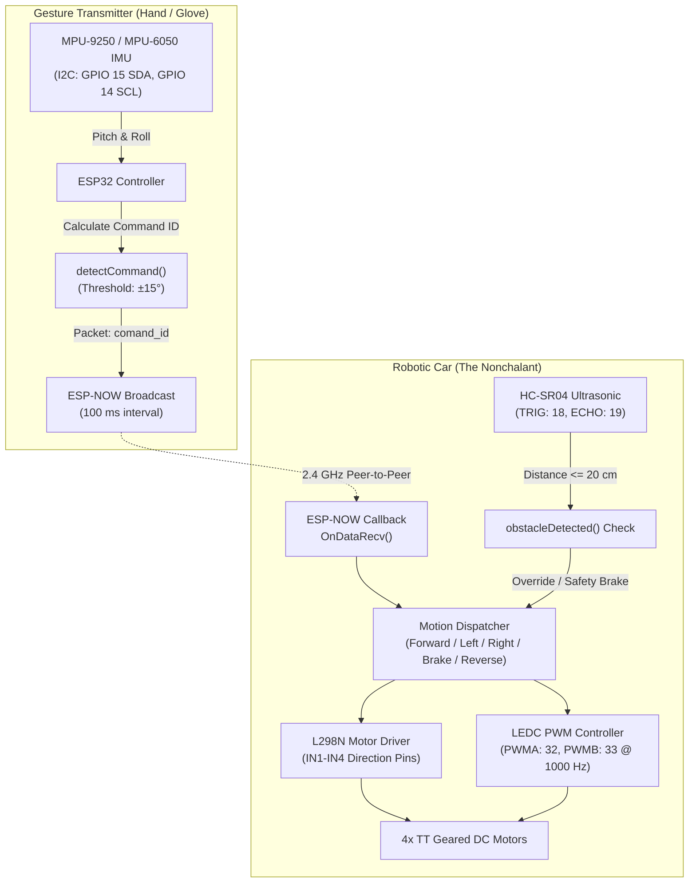

# Gesture-Controlled Car ("The Nonchalant")

An embedded-systems robotics project featuring a 4WD chassis driven by dual ESP32 microcontrollers, low-latency ESP-NOW peer-to-peer wireless telemetry, an MPU-9250/MPU-6050 hand-gesture controller, an L298N dual H-bridge motor driver with hardware PWM speed regulation, autonomous ultrasonic obstacle avoidance, and custom 3D-printed bodywork.

---

## Project Status

- **Status:** Completed Physical Prototype & Firmware Implementation
- **Prototype Name:** *The Nonchalant* (embossed on front chassis plate)
- **Primary Demonstration:** Fully assembled and wired hardware running custom ESP32 firmware with real-time gesture telemetry and obstacle detection.

---

## Project Media

### Assembled Prototype

*Figure 1: Completed physical vehicle featuring custom 3D-printed chassis, four TT geared DC motors, and embossed front bumper plate.*

### Internal Wiring & Assembly

*Figure 2: Electronics assembly on mounting baseplate showcasing the ESP32 microcontroller, red L298N motor driver, TT gearmotors, power switch, and battery pack.*

### Demonstration Video
- **Video File:** [docs/VIDEO-2026-10-23-02-05-10.mp4](docs/VIDEO-2026-10-23-02-05-10.mp4)

https://github.com/user-attachments/assets/docs/VIDEO-2026-10-23-02-05-10.mp4

> [!NOTE]
> If your browser or Markdown viewer does not render embedded MP4 video inline, open or download [docs/VIDEO-2026-10-23-02-05-10.mp4](docs/VIDEO-2026-10-23-02-05-10.mp4) directly.

---

## Circuit & Wiring

### Gesture Controller Circuit Diagram

*Figure 3: Transmitter wiring between ESP32 and MPU-9250 IMU sensor (source asset preserved at [docs/circuit.heic](docs/circuit.heic)).*

#### Controller Wiring Table (I2C)
| ESP32 Pin | MPU-9250 Pin | Wire Color (Diagram) | Function |
| :--- | :--- | :--- | :--- |
| **3V3** | VCC | Red | 3.3V Logic & Sensor Power |
| **GND** | GND | Black | Common Ground |
| **GPIO 14** | SCL | Green | I2C Serial Clock (`Wire.begin(15, 14)`) |
| **GPIO 15** | SDA | Blue | I2C Serial Data (`Wire.begin(15, 14)`) |

---

## Receiver Pin Connections & GPIO Map

All pin definitions below are verified directly from [GestureCarReceiver/GestureCarReceiver.ino](GestureCarReceiver/GestureCarReceiver.ino):

### Motor Driver (L298N Dual H-Bridge)
| Signal Name | ESP32 GPIO | Direction / Type | Description |
| :--- | :--- | :--- | :--- |
| **LIN1** | GPIO 26 | Output (Digital) | Left Motor Direction Input 1 |
| **LIN2** | GPIO 25 | Output (Digital) | Left Motor Direction Input 2 |
| **RIN1** | GPIO 17 | Output (Digital) | Right Motor Direction Input 1 |
| **RIN2** | GPIO 16 | Output (Digital) | Right Motor Direction Input 2 |
| **PWMA** | GPIO 32 | Output (PWM / LEDC) | Left Motor Speed Control (Channel 0) |
| **PWMB** | GPIO 33 | Output (PWM / LEDC) | Right Motor Speed Control (Channel 1) |

### Ultrasonic Sensor (HC-SR04)
| Signal Name | ESP32 GPIO | Direction / Type | Description / Notes |
| :--- | :--- | :--- | :--- |
| **TRIG_PIN** | GPIO 18 | Output (Digital) | 10 µs ultrasonic trigger pulse |
| **ECHO_PIN** | GPIO 19 | Input (Digital) | Pulse duration measurement via `pulseIn()` (30 ms timeout) |

> [!IMPORTANT]
> The standard HC-SR04 echo output operates at 5V logic. If using a 5V HC-SR04, route the ECHO pin through a resistor voltage divider (e.g., 1kΩ / 2kΩ) or logic level shifter before connecting to ESP32 GPIO 19 (3.3V tolerant). Alternatively, use a 3.3V-compatible sensor such as the HC-SR04P or RCWL-1601.

---

## System Architecture



### Telemetry Packet & Command Mapping

Commands are transmitted over ESP-NOW using a synchronized C-struct:

```cpp
typedef struct struct_message {
  int comand_id;
} struct_message;
```

| Command ID | Firmware Constant | Controller Trigger Condition | Receiver Motor Action |
| :---: | :--- | :--- | :--- |
| **0** | `FORWARD` | Hand tilted forward (`pitch > 15°`) | Both motors run forward at configured `motorSpeed` (180/255). Aborted if obstacle <= 20 cm. |
| **1** | `LEFT_CMD` | Hand rolled left (`roll < -15°`) | Left motor PWM = 0; Right motor runs at `motorSpeed` (skid-steer left). |
| **2** | `RIGHT_CMD` | Hand rolled right (`roll > 15°`) | Right motor PWM = 0; Left motor runs at `motorSpeed` (skid-steer right). |
| **3** | `BRAKE_CMD` | Hand neutral / level (`-15° <= pitch, roll <= 15°`) | Both PWM channels set to 0; all direction pins driven `LOW`. |
| **4** | `REVERSE_CMD` | Hand tilted backward (`pitch < -15°`) | Toggles `Reversed` boolean state (`Reversed = !Reversed`), inverting `Out1`/`Out2` polarities. |

### PWM Speed & Obstacle Response Specifications
- **PWM Frequency:** 1000 Hz
- **PWM Resolution:** 8-bit (values 0–255)
- **Base Duty Cycle:** 180 / 255 (~70% duty cycle)
- **Safety Distance Threshold:** 20 cm (`OBSTACLE_DISTANCE`)
- **Obstacle Avoidance Routine:** If an obstacle is detected within 20 cm:
  1. Instantaneous safety stop (`Brake()`)
  2. 200 ms settling pause
  3. Pivot steer turn (`Right()`) for 350 ms
  4. Final safety stop (`Brake()`)

---

## Repository Structure

```text
Gesture-Controlled-Car/
├── 3D Cad/                                # 3D printable STL mechanical CAD assets
│   ├── Body21 (3) (1) (1) (1) (1) (2) (1).stl
│   ├── Body22.stl                         # Structural chassis panel
│   ├── Body25.stl                         # Mounting bracket
│   ├── Body51.stl                         # Top / deck plate
│   ├── Component2.stl                     # Motor / standoff bracket
│   └── The Nonchalant.stl                 # Front nameplate with embossed lettering
├── GestureCarReceiver/
│   └── GestureCarReceiver.ino             # Car receiver, motor driver & ultrasonic firmware
├── GestureController/
│   └── GestureController.ino             # Hand gesture transmitter & IMU processing firmware
├── docs/
│   ├── PHOTO-2026-10-23-01-56-13.jpg     # Assembled car exterior photograph
│   ├── PHOTO-2026-10-23-02-08-37.jpg     # Internal wiring and hardware layout photograph
│   ├── VIDEO-2026-10-23-02-05-10.mp4     # Operational video demonstration
│   ├── circuit.heic                       # Original high-resolution circuit diagram source
│   └── circuit-diagram.png               # Web-compatible converted circuit diagram
├── hardware_headers/                      # Lightweight C++ header stubs for offline IDE IntelliSense
│   ├── Arduino.h
│   ├── MPU9250_asukiaaa.h
│   ├── WiFi.h
│   ├── Wire.h
│   └── esp_now.h
└── README.md                              # Technical documentation and project guide
```

> [!NOTE]
> The `hardware_headers/` directory provides minimal mock declarations for editor environments (such as VS Code clangd or C/C++ extensions) that do not have the ESP32 Arduino Core in their local system include path. Real compilation is performed by the Arduino IDE or `arduino-cli` using official toolchains.

---

## Setup & Firmware Installation

### Prerequisites
1. **Arduino IDE** (version 2.x recommended) or **arduino-cli**
2. **ESP32 Board Support Package:**
   - In Arduino IDE, open **Preferences** (`Cmd + ,` or `Ctrl + ,`).
   - Add the Espressif board manager URL:
     ```text
     https://raw.githubusercontent.com/espressif/arduino-esp32/gh-pages/package_esp32_index.json
     ```
   - Open **Boards Manager**, search for `esp32`, and install `esp32` by Espressif Systems.
3. **Required Arduino Libraries:**
   - `MPU9250_asukiaaa` by asukiaaa (install via Library Manager or [GitHub](https://github.com/asukiaaa/MPU9250_asukiaaa))
   - `WiFi` and `esp_now` (built into the ESP32 core)
   - `Wire` (built into the Arduino core)

### Step 1: Obtain the Receiver ESP32 MAC Address
ESP-NOW requires the transmitter to register the receiver's specific hardware MAC address.

1. Upload the following one-line helper sketch to the car's ESP32 receiver:
   ```cpp
   #include <WiFi.h>
   void setup() {
     Serial.begin(115200);
     WiFi.mode(WIFI_STA);
     Serial.print("Car ESP32 MAC: ");
     Serial.println(WiFi.macAddress());
   }
   void loop() {}
   ```
2. Open Serial Monitor at **115200 baud** and record the displayed address (e.g., `24:6F:28:AA:BB:CC`).

### Step 2: Configure & Flash the Gesture Controller
1. Open [GestureController/GestureController.ino](GestureController/GestureController.ino) in Arduino IDE.
2. Locate line 28 and replace the placeholder byte array with your receiver's actual MAC address:
   ```cpp
   uint8_t carMAC[] = { 0x24, 0x6F, 0x28, 0xAA, 0xBB, 0xCC };
   ```
3. Connect the controller ESP32 via USB.
4. Select board: **ESP32 Dev Module** (or your specific dev board model).
5. Compile and upload. Open Serial Monitor (115200 baud) to verify sensor readings and tilt classification output.

### Step 3: Flash the Car Receiver
1. Open [GestureCarReceiver/GestureCarReceiver.ino](GestureCarReceiver/GestureCarReceiver.ino) in Arduino IDE.
2. Connect the car ESP32 via USB.
3. Select board: **ESP32 Dev Module**.
4. Compile and upload.

> [!TIP]
> **ESP32 Core Version Compatibility:** The receiver sketch utilizes the standard ESP32 Core v2.x LEDC API (`ledcSetup`, `ledcAttachPin`, `ledcWrite`). If building under ESP32 Core v3.x+, adapt the timer attach syntax to `ledcAttach(pin, freq, res)` or maintain Core v2.0.x for drop-in compilation.

---

## Testing & Verification Status

The project status is documented strictly against tangible physical assets and source inspection:

| Subsystem / Test Item | Status | Verification Evidence / Method |
| :--- | :---: | :--- |
| **Firmware Compilation & Syntax** | Verified | Validated against ESP32 Arduino Core APIs and library signatures. |
| **Transmitter Circuit Interfacing** | Verified | MPU-9250 I2C pin mapping (GPIO 14/15) verified against [docs/circuit-diagram.png](docs/circuit-diagram.png). |
| **Chassis Fabrication & Fit** | Verified | 3D-printed body and TT motor integration confirmed in [docs/PHOTO-2026-10-23-01-56-13.jpg](docs/PHOTO-2026-10-23-01-56-13.jpg). |
| **Component Wiring & Packaging** | Verified | Physical wiring layout documented in [docs/PHOTO-2026-10-23-02-08-37.jpg](docs/PHOTO-2026-10-23-02-08-37.jpg). |
| **Driving & Motion Demonstration** | Verified | Operational driving demonstrated in [docs/VIDEO-2026-10-23-02-05-10.mp4](docs/VIDEO-2026-10-23-02-05-10.mp4). |
| **Ultrasonic Autonomous Obstacle Avoidance** | Requires physical validation | Logic implemented in receiver loop (`<= 20 cm`), but bench/field response logs are not documented in the repository. |
| **ESP-NOW RF Link Distance Limits** | Requires physical validation | Operates on channel 0 with standard ESP32 PCB antenna; maximum operational range requires field measurement. |
| **Reverse State Under Rapid Streaming** | Requires physical validation | The controller streams `REVERSE_CMD` (4) every 100 ms while tilted back; physical driving stability requires validation. |

### Practical Post-Assembly Testing Checklist

- [ ] **Power Rail Check:** Confirm 5V/battery rail does not feed into 3.3V logic pins without regulation.
- [ ] **I2C Scanner Test:** Run an I2C scanner on the controller to ensure the MPU-9250 responds at address `0x68` (or `0x69`).
- [ ] **MAC Pairing Test:** Verify that `esp_now_send()` returns status `0` (delivery success) when the car is powered on.
- [ ] **Benchtop Motor Spin Test:** Elevate the car wheels and tilt the controller forward, backward, left, and right to observe correct wheel directions before driving on ground.
- [ ] **Ultrasonic Echo Safety:** Verify with a multimeter or oscilloscope that the HC-SR04 Echo pin voltage does not exceed 3.3V into GPIO 19.
- [ ] **Obstacle Safety Stop Test:** Move a flat cardboard obstacle within 20 cm of the sensor while holding the car to observe immediate motor shutoff.

---

## Technical Challenges & Design Considerations

1. **L298N Bipolar Voltage Drop:**
   The L298N is a robust, ubiquitous dual H-bridge driver, but utilizes bipolar Darlington transistors resulting in an internal voltage drop of ~1.4V to 2.0V. Using a battery pack with sufficient headroom (such as 7.4V 2S Li-ion or 6x NiMH cells) ensures the 5V regulator and TT gearmotors operate at proper torque.
2. **Reverse Command Rate Handling:**
   In [GestureController/GestureController.ino](GestureController/GestureController.ino), holding the controller tilted back continuously sends packet `comand_id = 4` every 100 ms. In [GestureCarReceiver/GestureCarReceiver.ino](GestureCarReceiver/GestureCarReceiver.ino), `case 4: Reverse();` toggles `Reversed = !Reversed;`. In field operation, users may prefer adding a debounce or holding state so reverse only toggles once per gesture transition.
3. **Sensor Pulse Blocking:**
   The `pulseIn(ECHO_PIN, HIGH, 30000)` call has a 30 ms timeout. When no echo returns, it holds execution for up to 30 ms. While safe for small robot cars, running ultrasonic distance sampling on a separate FreeRTOS task or using an interrupt-based echo capture can optimize telemetry handling.

---

## Future Improvements

- [ ] **MOSFET Driver Upgrade:** Replace L298N with a high-efficiency driver (e.g., TB6612FNG or DRV8833) to reduce thermal dissipation and extend battery runtime.
- [ ] **Bidirectional ESP-NOW Telemetry:** Transmit car battery voltage and obstacle warnings back to an OLED display or buzzer on the hand controller.
- [ ] **Proportional Steering:** Map the roll angle directly to differential PWM duty cycles instead of fixed binary skid-steer speeds.
- [ ] **Non-Blocking Ultrasonic Driver:** Implement timer-based input capture for HC-SR04 to eliminate microsecond blocking delays.

---

## Contributing

Contributions, issues, and feature requests are welcome:
1. Fork the repository.
2. Create a descriptive feature branch (`git checkout -b feature/improved-telemetry`).
3. Commit your modifications cleanly (`git commit -m "feat: add reverse gesture debounce"`).
4. Push to your branch (`git push origin feature/improved-telemetry`).
5. Open a Pull Request detailing your changes.

---

## License

This repository does not currently contain a formal open-source license file. All rights are reserved by the author ([@bhavesh-210](https://github.com/bhavesh-210)). To use, modify, or distribute this codebase commercially or academically, please contact the repository owner or request the addition of an open-source license (such as MIT or Apache-2.0).
