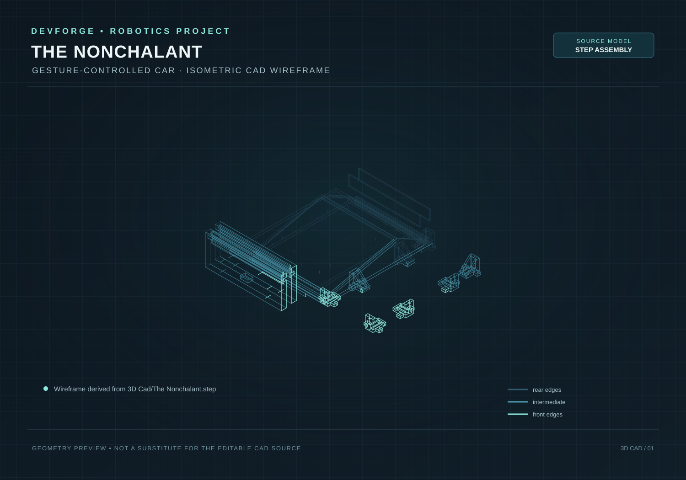

# Gesture-Controlled Car — The Nonchalant

A 4WD robotic car controlled using hand gestures. The project uses two ESP32 microcontrollers communicating over ESP-NOW, an MPU-9250 IMU on the hand controller to measure tilt angles, an L298N motor driver with PWM speed regulation on the car, an HC-SR04 ultrasonic sensor for obstacle avoidance, and a custom 3D-printed chassis.


For the detailed 5-stage build log with design entries, testing notes, and time allocations, check out [JOURNAL.md](JOURNAL.md).

## Project Overview

Instead of controlling the car with a smartphone screen or a standard analog joystick, this project lets you drive the car using natural hand movements:
- Tilt your hand forward to drive forward.
- Tilt left or right to steer.
- Keep your hand flat to brake.
- Tilt back to toggle reverse.

The transmitter reads your hand's pitch and roll using an MPU-9250 sensor and broadcasts command packets to the car over ESP-NOW every 100 ms. The car executes the commands and uses a front-facing HC-SR04 ultrasonic sensor to detect obstacles within 20 cm, automatically stopping and steering away to avoid collisions.

### Demo Video

Watch the car in action: [Project Demo Video](docs/VIDEO-2026-10-23-02-05-10.mp4)

### Key Features

- Direct ESP-NOW wireless: Fast, peer-to-peer transmission between two ESP32s with low latency and without needing a Wi-Fi router.
- 5 discrete gesture commands: Forward, Left turn, Right turn, Brake/Stop, and Reverse toggle.
- Hardware PWM speed control: Uses ESP32 LEDC PWM channels at 1000 Hz for smooth acceleration and speed regulation.
- Collision avoidance: HC-SR04 ultrasonic sensor automatically halts and pivots the car if an obstacle is within 20 cm.
- Custom 3D-printed chassis: Designed in Autodesk Fusion 360 to house four TT gear motors, battery pack, motor driver, and microcontrollers.

---

## Hardware & Circuit Design

### Wiring Diagram & Build Photos

#### Circuit Schematic

*Schematic wiring for transmitter ESP32 and MPU-9250 IMU.*

#### Assembled Chassis & Electronics

*Internal wiring showing ESP32 receiver, L298N driver, TT gearmotors, battery pack, and power switch.*

### Bill of Materials (BOM)

| Item | Component | Qty | Approx Price (INR) | Total (INR) | Source / Buying Link | Purpose |
| :--- | :--- | :---: | ---: | ---: | :--- | :--- |
| ESP32 Dev Board | ESP-WROOM-32 (30-pin) | 2 | ₹400.00 | ₹800.00 | [ElectronicsComp](https://www.electronicscomp.com/esp32-development-board-with-wifi-bluetooth-india) | 1x transmitter, 1x car receiver |
| IMU Sensor | MPU-9250 9-axis module | 1 | ₹442.00 | ₹442.00 | [ElectronicsComp](https://www.electronicscomp.com/development-board-programmer/arduino/mpu9250-9-axis-gyro-accelerometer-module?limit=50) | Hand tilt angle detection |
| Motor Driver | L298N Dual H-Bridge | 1 | ₹186.00 | ₹186.00 | [ElectronicsComp](https://www.electronicscomp.com/stepper-motor-drivers/l298n-dual-h-bridge-dc-stepper-motor-driver-controller-module) | Drives the 4 DC motors with PWM |
| Geared Motors | Yellow BO DC motors (6V) | 4 | ₹128.00 | ₹512.00 | [Robu.in](https://robu.in/product-category/straight-bo-motors/) | 4WD drivetrain |
| Wheels | 65 mm rubber wheels | 4 | ₹45.00 | ₹180.00 | [ElectronicsComp](https://www.electronicscomp.com/65mm-robot-wheel-for-bo-motors-yellow) | Pressed onto TT motor shafts |
| Distance Sensor | HC-SR04 ultrasonic sensor | 1 | ₹79.00 | ₹79.00 | [Robu.in](https://robu.in/product/hc-sr04-ultrasonic-range-finder/) | Front obstacle detection |
| Battery Pack | 7.4V 2S Li-ion rechargeable pack | 1 | ₹765.00 | ₹765.00 | [ElectronicsComp](https://www.electronicscomp.com/7.4v-2600mah-li-ion-battery-pack-inbuilt-bms-protection) | Main power supply for car |
| Jumper Wires | M-F and M-M jumpers (40 pcs) | 1 pack | ₹64.00 | ₹64.00 | [ElectronicsComp](https://www.electronicscomp.com/male-to-female-jumper-wires-10cm-40-pieces-pack) | Prototyping & connections |
| Power Switch | SPST rocker switch | 1 | ₹20.00 | ₹20.00 | Local electronics shop | Master power toggle |
| 3D Chassis Parts | 3D printed PLA chassis parts | 1 set | ₹0.00 | ₹0.00 | Self-printed ([3D Cad/](3D%20Cad)) | Frame, deck plates, and brackets |

A complete CSV version is available in [BOM.csv](BOM.csv).

---

## Pinout & Connections

### Hand Controller Wiring (I2C)

| ESP32 Pin | MPU-9250 Pin | Wire Color (in diagram) | Function |
| :--- | :--- | :--- | :--- |
| **3V3** | VCC | Red | 3.3V Power |
| **GND** | GND | Black | Ground |
| **GPIO 14** | SCL | Green | I2C Clock |
| **GPIO 15** | SDA | Blue | I2C Data |

### Car Receiver Pinout

| Signal | ESP32 GPIO | Direction | Function |
| :--- | :--- | :--- | :--- |
| **LIN1** | GPIO 26 | Output | Left motor direction 1 |
| **LIN2** | GPIO 25 | Output | Left motor direction 2 |
| **RIN1** | GPIO 17 | Output | Right motor direction 1 |
| **RIN2** | GPIO 16 | Output | Right motor direction 2 |
| **PWMA** | GPIO 32 | Output (PWM) | Left motor speed (LEDC Channel 0) |
| **PWMB** | GPIO 33 | Output (PWM) | Right motor speed (LEDC Channel 1) |
| **TRIG_PIN** | GPIO 18 | Output | Ultrasonic trigger pulse (10 µs) |
| **ECHO_PIN** | GPIO 19 | Input | Ultrasonic echo pulse |

*Note on ECHO Pin Voltage:* The HC-SR04 runs on 5V and outputs 5V on ECHO. Because ESP32 pins are rated for 3.3V, use a simple resistor divider (1kΩ and 2kΩ) on the ECHO pin to drop the signal safely to 3.3V before connecting to GPIO 19.

---

## Gesture Commands

The hand controller calculates pitch and roll from accelerometer data:
```cpp
float pitch = atan2(ax, sqrt(ay * ay + az * az)) * 180 / PI;
float roll  = atan2(ay, sqrt(ax * ax + az * az)) * 180 / PI;
```

Tilt angles map directly to movement commands:

| Command ID | Name | Hand Tilt Condition | Car Action |
| :---: | :--- | :--- | :--- |
| **0** | `FORWARD` | Hand tilted forward (`pitch > 15°`) | Both motors run forward at set speed |
| **1** | `LEFT_CMD` | Hand tilted left (`roll < -15°`) | Left motor stops, right motor runs forward |
| **2** | `RIGHT_CMD` | Hand tilted right (`roll > 15°`) | Right motor stops, left motor runs forward |
| **3** | `BRAKE_CMD` | Hand flat/level (`-15° <= pitch, roll <= 15°`) | All motor pins LOW, PWM set to 0 |
| **4** | `REVERSE_CMD` | Hand tilted back (`pitch < -15°`) | Toggles direction polarity to drive in reverse |

---

## How to Set Up & Flash

### Prerequisites
1. Install [Arduino IDE](https://www.arduino.cc/en/software).
2. Add ESP32 board support via Boards Manager (`esp32` by Espressif Systems).
3. Install the `MPU9250_asukiaaa` library from the Arduino Library Manager.

### Uploading Code
1. **Find Receiver MAC Address:** Flash a simple sketch with `WiFi.macAddress()` to your car's ESP32 and open Serial Monitor to get its MAC address.
2. **Configure Controller:** Open `GestureController/GestureController.ino` and replace `carMAC` with your car ESP32's MAC address:
   ```cpp
   uint8_t carMAC[] = { 0x24, 0x6F, 0x28, 0xAA, 0xBB, 0xCC };
   ```
3. **Flash Controller:** Upload `GestureController/GestureController.ino` to the hand controller ESP32.
4. **Flash Receiver:** Upload `GestureCarReceiver/GestureCarReceiver.ino` to the car ESP32.

*Note on ESP32 Core:* The receiver code uses the ESP32 Core v2.x LEDC API (`ledcSetup`, `ledcAttachPin`, `ledcWrite`). If compiling under Core v3.x+, adjust to the newer `ledcAttach` function syntax.

---

## Testing & Lessons Learned

- **Bench Testing:** Always prop the car up with wheels off the ground when testing initial code. This confirms that all tilt angles spin the wheels in the right direction without runaway accidents.
- **L298N Voltage Drop:** The L298N motor driver drops roughly 1.5V to 2.0V across its internal transistors. A standard 4.8V or 5V supply leaves too little voltage for the motors under chassis weight. Using a 7.4V 2S battery pack provides plenty of torque.
- **Reverse Toggle Debounce:** Tilting backward repeatedly streams command `4` every 100 ms. Since command 4 toggles reverse mode, holding the gesture flips the direction repeatedly. Tilt back briefly to toggle, or add software state debouncing in firmware.
- **Non-blocking Ultrasonic:** The `pulseIn()` function waits up to 30 ms if no echo is returned. In future revisions, using a non-blocking timer or FreeRTOS task will keep the main loop completely unblocked.

---

## 3D CAD Files


*Chassis wireframe derived from 3D Cad/The Nonchalant.step.*

The [3D Cad/](3D%20Cad/) folder contains the full CAD project and solid models for 3D printing:

- **Autodesk Fusion 360 Source:**
  - `The Nonchalant (1).f3d`: Fully editable design archive with sketches, parameters, and timeline.
- **STEP Solid Models (3D printable):**
  - `The Nonchalant.step`: Front nameplate bumper
  - `Body22.step`: Lower chassis baseplate
  - `Body51.step`: Upper deck plate for electronics
  - `Component2.step`: Motor mounting standoff
  - `Body25.step`: Frame bracket
  - `Body21 (...).step`: Side wheel clearance plate

These parts can be sliced directly in PrusaSlicer, Cura, or Bambu Studio, or edited in Fusion 360 and FreeCAD.

---

## Future Improvements

- Replace the L298N with a modern MOSFET motor driver (such as TB6612FNG or DRV8833) to reduce voltage drop and improve battery life.
- Add two-way telemetry so the car can report battery voltage and obstacle alerts back to the controller.
- Proportional steering to vary turn speed based on how far your hand tilts.
- Non-blocking ultrasonic measurement with FreeRTOS tasks.

---

## Author & Credits

Built and documented by Bhavesh Sharma ([@bhavesh-210](https://github.com/bhavesh-210)). Feel free to use the code and CAD models for your own DIY robotics projects.
